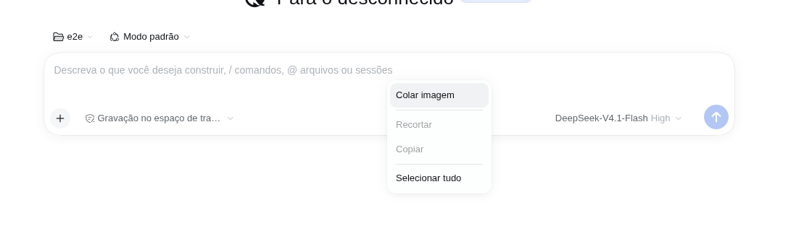
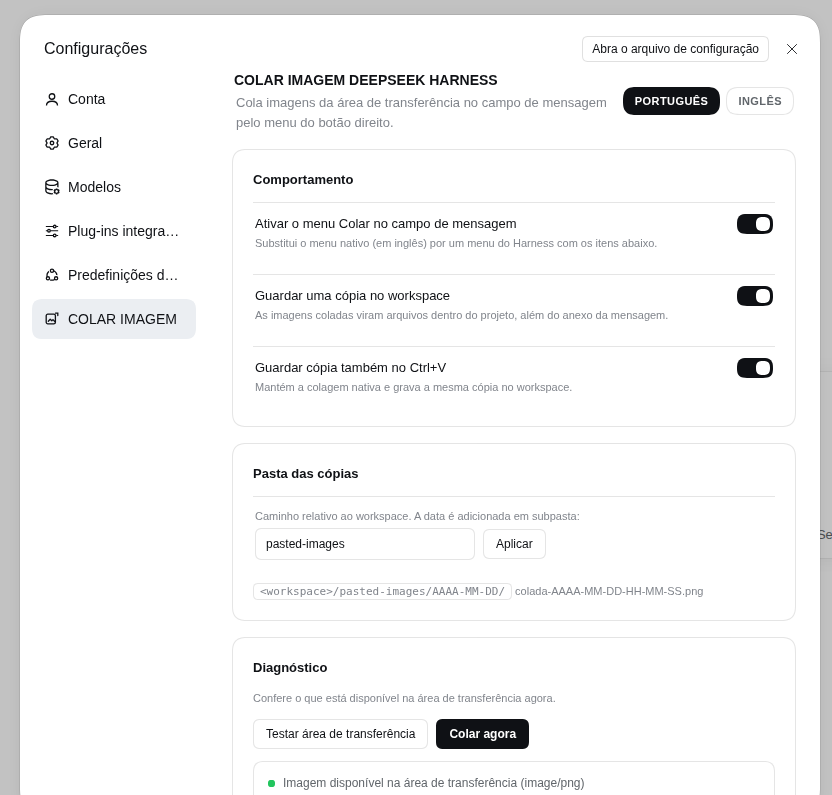

# COLAR IMAGEM DEEPSEEK HARNESS

[Português (BR)](./README.pt-BR.md) | **English**

Paste clipboard images into the **DeepSeek Harness Desktop** composer with the **right mouse button → Paste**. The image is attached to the draft through the native pipeline (thumbnail, upload, limits) and a copy is written under `pasted-images/YYYY-MM-DD/` inside the session workspace.



## Why

`Ctrl+V` already works in the Harness composer, but the desktop shell's context menu is **English-only and its Paste role does not handle clipboard-only images** (screenshots copied from a capture tool). This plugin replaces the composer context menu with the Harness' own localized menu and adds a **Colar imagem / Paste image** action that reads the system clipboard from the Host and feeds the same native attachment path.

## Features

- **Colar imagem** in the composer's right-click menu, localized (Portuguese / English).
- Image is **attached to the draft** exactly like a native paste: preview thumbnail, upload progress, size/count limits and Host refusal messages all keep working.
- **Workspace copy** of every pasted image: `<workspace>/pasted-images/YYYY-MM-DD/colada-YYYY-MM-DD-HH-MM-SS.png` (folder and date grouping are configurable).
- **Ctrl+V untouched**: the native paste keeps working; the plugin can also keep a copy for it (on by default).
- Menu also keeps **Recortar / Copiar / Selecionar tudo** (Cut / Copy / Select all) so the composer is not left without the basic editing items.
- **Fallback to text**: when the clipboard holds text, the menu becomes a plain **Colar / Paste** and inserts the text at the caret.
- **Settings → COLAR IMAGEM**: enable/disable, workspace copies, Ctrl+V copies, copies folder, and a clipboard diagnostics panel.
- **No clipboard permission prompts**: the Host reads the clipboard with the desktop's own tools (`wl-paste`/`xclip`, `pbpaste`, PowerShell), so the browser never asks for `clipboard-read`.
- **Local only**: routes are loopback + same-origin fenced; bytes never leave the machine and never reach a model beyond the normal attachment.



## Install

Requires DeepSeek Harness Desktop `0.2.2-rc.1` or newer (`<0.3.0`).

```sh
# Desktop app profile
dsh plugin --profile desktop add dsh-colar-imagem-deepseek-harness
```

Or install a local tarball:

```sh
dsh plugin --profile desktop add ./dsh-colar-imagem-deepseek-harness-0.1.0.tgz
```

Then **restart the Desktop app** (the Host half registers HTTP routes at startup; reloading the page is not enough). From the GUI you can also use **Plug-ins → Adicionar plugin** with the package name or a local directory.

## Usage

1. Copy an image to the clipboard (screenshot tool, or "Copy image" in another app).
2. **Right-click inside the message field** → **Colar imagem**.
3. The image appears in the draft attachment rail, and the toast tells you where the workspace copy was saved.

The plugin also appears under **Settings → COLAR IMAGEM**, with:

- **Ativar o menu Colar no campo de mensagem** — turns the context menu replacement on/off.
- **Guardar uma cópia no workspace** — writes `pasted-images/...` next to the message attachment.
- **Guardar cópia também no Ctrl+V** — keeps native Ctrl+V and writes the same workspace copy.
- **Pasta das cópias** — workspace-relative folder (default `pasted-images`).
- **Diagnóstico** — checks the clipboard now and can paste immediately.

## Configuration

Everything has a working default. Override fields in the profile's `cordis.patch.yml`:

```yaml
- id: colar-imagem-deepseek-harness
  config:
    pastedDir: pasted-images
    dateFolders: true
    saveNativePastes: true
    maxClipboardBytes: 52428800
    clipboardTimeoutMs: 5000
```

| Field | Default | Meaning |
|---|---|---|
| `pastedDir` | `pasted-images` | Workspace-relative folder for the copies. Absolute paths and `..` fall back to the default. |
| `dateFolders` | `true` | Add a `YYYY-MM-DD` subfolder per day. |
| `saveNativePastes` | `true` | Default for the “Ctrl+V too” setting (the user setting wins after the first save). |
| `maxClipboardBytes` | `50 MiB` | Largest image accepted from the clipboard. |
| `clipboardTimeoutMs` | `5000` | Budget for each system clipboard tool invocation. |

The user-facing settings (toggles/folder/language) are stored in the browser's `localStorage`; the Host configuration above only supplies the defaults.

## Clipboard backends

| System | Image | Text |
|---|---|---|
| Linux / X11 | `xclip` | `xclip` |
| Linux / Wayland | `wl-paste` (`wl-clipboard`) | `wl-paste` |
| macOS | `osascript` + `pbpaste` | `pbpaste` |
| Windows | PowerShell + Windows Forms | PowerShell + Windows Forms |

Linux (X11 and Wayland) is the tested target; macOS and Windows paths are implemented as best-effort and have no CI coverage. If no backend is available, the browser clipboard API is used as a fallback (may require the desktop shell to grant `clipboard-read`).

## Workspace layout

```text
<session workspace>/
└── pasted-images/
    └── 2026-11-10/
        ├── colada-2026-11-10-00-14-06.png
        └── colada-2026-11-10-00-14-07.png
```

Existing files are never overwritten: a numeric suffix is added (`colada-....-2.png`). Identical pastes are kept as separate files (the native attachment store handles deduplication for the model).

## Privacy and security

- The two Host routes (`/colar-imagem-deepseek-harness/clipboard`, `/read`, `/save`) only accept requests from the local page: loopback `Host`, `Origin` equal to the Host and `Sec-Fetch-Site: same-origin|none`. Cross-site pages get `403`.
- Clipboard bytes are read on the machine, written inside the session workspace and returned to the page that requested them. Nothing is uploaded by the plugin.
- The plugin never reads or stores model credentials.

## Limitations

- The composer context menu is **replaced** while the plugin is active. Undo/redo stay on `Ctrl+Z` / `Ctrl+Shift+Z`; the menu offers Paste, Cut, Copy and Select All.
- Copy/Cut use the browser editing commands; a browser that refuses the command reports a toast instead of copying.
- Only clipboard **image data** (and text) is handled. A file copied in a file manager as a file reference (`text/uri-list`) is not turned into an attachment in `0.1.0`.
- On Wayland the desktop must expose `wl-clipboard` (`wl-paste`); otherwise use the browser fallback.
- Copies are never deleted automatically; clean up the folder when it gets large.
- macOS/Windows backends are not covered by automated tests yet.

## Development

```sh
npm test              # unit tests (clipboard parsing, paths, routes helpers)
npm run validate      # package/catalog checks (also runs on prepack)
dev/run-e2e.sh        # isolated DSH web + Xvfb clipboard + Puppeteer end-to-end
npm pack              # produces dsh-colar-imagem-deepseek-harness-<version>.tgz
```

The end-to-end script starts its own `DSH_HOME`, Xvfb display, PNG clipboard and `dsh web` instance, then verifies: menu opens, “Colar imagem” attaches the image, the workspace file is written, the text menu variant works, the Ctrl+V hook writes a copy, and the Settings section renders and reads the clipboard (18 checks).

## Publishing

`publish/` contains the community catalog entry, an index reference and a Portuguese walkthrough (`PRIMEIRA-PUBLICACAO.md`). `npm run publish:npm` runs tests + validation and publishes to npm. Set the GitHub owner with `node scripts/set-owner.mjs <user>` if the repository is not under `wgrbiss-spec`.

## License

MIT © wgrbiss-spec
