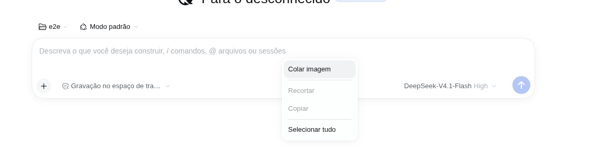
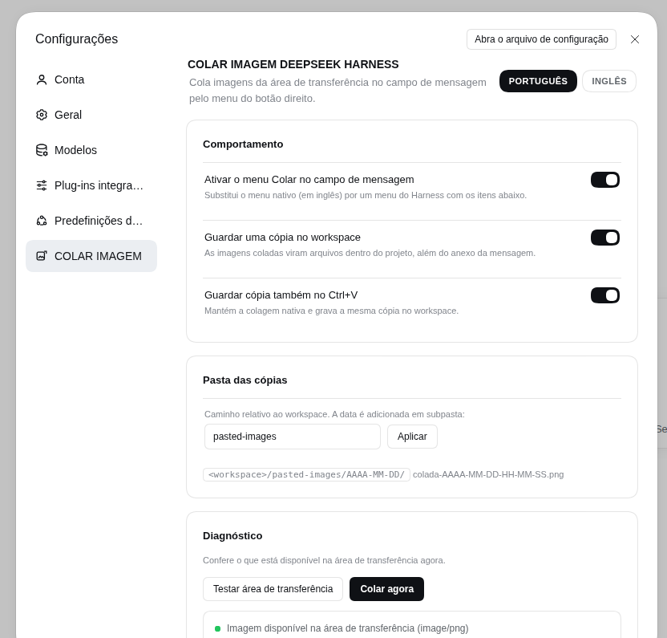

# COLAR IMAGEM DEEPSEEK HARNESS

**Português (BR)** | [English](./README.md)

Cola imagens da área de transferência no campo de mensagem do **DeepSeek Harness Desktop** com o **botão direito do mouse → Colar**. A imagem entra no rascunho pelo pipeline nativo (prévia, upload, limites) e uma cópia é gravada em `pasted-images/AAAA-MM-DD/` dentro do workspace da sessão.



## Por que existe

O `Ctrl+V` já funciona no composer do Harness, mas o menu de contexto do shell desktop é **em inglês e o item “Paste” não lida com imagens que estão só no clipboard** (prints de ferramentas de captura). Este plugin troca o menu de contexto do campo de mensagem pelo menu localizado do Harness e adiciona **Colar imagem**, lendo a área de transferência no Host e alimentando o mesmo caminho nativo de anexos.

## Recursos

- **Colar imagem** no menu do botão direito do composer, em português e inglês.
- A imagem é **anexada ao rascunho** como na colagem nativa: prévia, progresso de upload, limites de tamanho/quantidade e mensagens de recusa do Host continuam funcionando.
- **Cópia no workspace** de cada imagem colada: `<workspace>/pasted-images/AAAA-MM-DD/colada-AAAA-MM-DD-HH-MM-SS.png` (pasta e agrupamento por data configuráveis).
- **Ctrl+V intacto**: a colagem nativa continua igual; o plugin pode guardar cópia dela também (ligado por padrão).
- O menu mantém **Recortar / Copiar / Selecionar tudo** para o composer não ficar sem os itens básicos de edição.
- **Fallback para texto**: se o clipboard tiver texto, o menu vira **Colar** simples e insere o texto no cursor.
- **Configurações → COLAR IMAGEM**: ligar/desligar, cópias no workspace, cópias do Ctrl+V, pasta das cópias e painel de diagnóstico da área de transferência.
- **Sem pedido de permissão de clipboard**: o Host lê a área de transferência com as ferramentas do próprio sistema (`wl-paste`/`xclip`, `pbpaste`, PowerShell), então o navegador nunca pede `clipboard-read`.
- **Tudo local**: as rotas são restritas a loopback + mesma origem; os bytes não saem da máquina e não chegam ao modelo além do anexo normal.



## Instalação

Requer DeepSeek Harness Desktop `0.2.2-rc.1` ou mais novo (`<0.3.0`).

```sh
# perfil do app Desktop
dsh plugin --profile desktop add dsh-colar-imagem-deepseek-harness
```

Ou instale um tarball local:

```sh
dsh plugin --profile desktop add ./dsh-colar-imagem-deepseek-harness-0.1.0.tgz
```

Depois **reinicie o app Desktop** (a metade host registra rotas HTTP na inicialização; recarregar a página não basta). Pela interface também dá para usar **Plug-ins → Adicionar plugin** com o nome do pacote ou um diretório local.

## Uso

1. Copie uma imagem para a área de transferência (print, ou “Copiar imagem” em outro app).
2. **Clique com o botão direito no campo de mensagem** → **Colar imagem**.
3. A imagem aparece na barra de anexos do rascunho e o aviso mostra onde a cópia foi salva.

A página **Configurações → COLAR IMAGEM** traz:

- **Ativar o menu Colar no campo de mensagem** — liga/desliga a troca do menu de contexto.
- **Guardar uma cópia no workspace** — grava `pasted-images/...` junto do anexo da mensagem.
- **Guardar cópia também no Ctrl+V** — mantém a colagem nativa e grava a mesma cópia.
- **Pasta das cópias** — pasta relativa ao workspace (padrão `pasted-images`).
- **Diagnóstico** — confere o clipboard agora e permite colar na hora.

## Configuração

Tudo tem padrão funcional. Sobrescreva campos no `cordis.patch.yml` do perfil:

```yaml
- id: colar-imagem-deepseek-harness
  config:
    pastedDir: pasted-images
    dateFolders: true
    saveNativePastes: true
    maxClipboardBytes: 52428800
    clipboardTimeoutMs: 5000
```

| Campo | Padrão | Significado |
|---|---|---|
| `pastedDir` | `pasted-images` | Pasta relativa ao workspace para as cópias. Caminho absoluto e `..` caem no padrão. |
| `dateFolders` | `true` | Cria subpasta `AAAA-MM-DD` por dia. |
| `saveNativePastes` | `true` | Padrão da opção “Ctrl+V também” (a escolha do usuário passa a valer depois do primeiro uso). |
| `maxClipboardBytes` | `50 MiB` | Maior imagem aceita do clipboard. |
| `clipboardTimeoutMs` | `5000` | Orçamento de cada chamada às ferramentas de clipboard. |

As preferências da página (interruptores/pasta/idioma) ficam no `localStorage` do navegador; a configuração do Host acima só define os padrões.

## Backends de clipboard

| Sistema | Imagem | Texto |
|---|---|---|
| Linux / X11 | `xclip` | `xclip` |
| Linux / Wayland | `wl-paste` (`wl-clipboard`) | `wl-paste` |
| macOS | `osascript` + `pbpaste` | `pbpaste` |
| Windows | PowerShell + Windows Forms | PowerShell + Windows Forms |

Linux (X11 e Wayland) é o alvo testado; macOS e Windows estão implementados como best-effort e não têm cobertura de CI. Se nenhum backend existir, o plugin usa a API de clipboard do navegador como fallback (pode exigir liberação de `clipboard-read` pelo shell).

## Layout no workspace

```text
<workspace da sessão>/
└── pasted-images/
    └── 2026-11-10/
        ├── colada-2026-11-10-00-14-06.png
        └── colada-2026-11-10-00-14-07.png
```

Arquivos existentes nunca são sobrescritos: um sufixo numérico é adicionado (`colada-....-2.png`). Colagens idênticas viram arquivos separados (a deduplicação do anexo para o modelo é feita pelo store nativo).

## Privacidade e segurança

- As rotas do Host (`/colar-imagem-deepseek-harness/clipboard`, `/read`, `/save`) só aceitam requisição da página local: `Host` loopback, `Origin` igual ao Host e `Sec-Fetch-Site: same-origin|none`. Página de outro site recebe `403`.
- Os bytes são lidos na máquina, gravados dentro do workspace da sessão e devolvidos para a página que pediu. O plugin não envia nada para fora.
- O plugin não lê nem guarda credenciais de modelo.

## Limitações

- Enquanto o plugin está ativo, o menu de contexto do composer é **substituído**. Desfazer/refazer continuam em `Ctrl+Z` / `Ctrl+Shift+Z`; o menu oferece Colar, Recortar, Copiar e Selecionar tudo.
- Copiar/Recortar usam os comandos de edição do navegador; se o navegador recusar, um aviso aparece em vez de copiar.
- Só dados de **imagem** (e texto) são tratados. Um arquivo copiado no gerenciador de arquivos como referência (`text/uri-list`) não vira anexo na `0.1.0`.
- No Wayland o desktop precisa expor `wl-clipboard` (`wl-paste`); caso contrário, use o fallback do navegador.
- As cópias nunca são apagadas automaticamente; limpe a pasta quando crescer.
- Os backends de macOS/Windows ainda não têm testes automatizados.

## Desenvolvimento

```sh
npm test              # testes unitários (parsing do clipboard, caminhos, helpers das rotas)
npm run validate      # checagens de pacote/catálogo (também roda no prepack)
dev/run-e2e.sh        # DSH web isolado + clipboard no Xvfb + Puppeteer ponta a ponta
npm pack              # gera dsh-colar-imagem-deepseek-harness-<versão>.tgz
```

O script ponta a ponta sobe `DSH_HOME` próprio, display Xvfb, PNG no clipboard e uma instância `dsh web`; depois verifica: menu abre, “Colar imagem” anexa a imagem, o arquivo é gravado no workspace, a variante de texto do menu funciona, o hook do Ctrl+V grava cópia e a seção de Configurações renderiza e lê o clipboard (18 verificações).

## Publicação

`publish/` contém a entrada do catálogo comunitário, uma referência de `index.json` e o passo a passo em português (`PRIMEIRA-PUBLICACAO.md`). `npm run publish:npm` roda testes + validação e publica no npm. Para trocar o dono do GitHub use `node scripts/set-owner.mjs <usuario>` caso o repositório não fique em `wgrbiss-spec`.

## Licença

MIT © wgrbiss-spec
